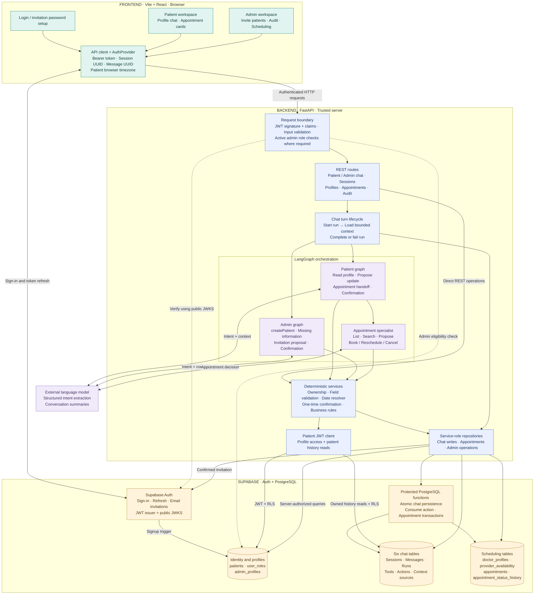
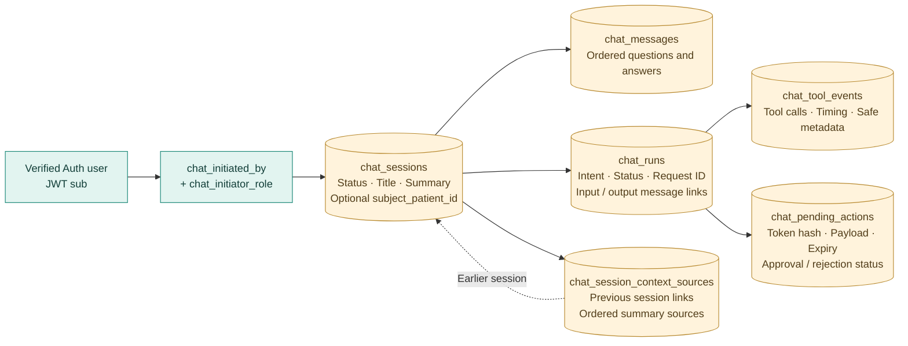

# Careline architecture and request flows

Implementation snapshot: October 11, 2026. Read the system map first, then the chat sequence and data map. These describe the implemented application; deployment infrastructure and future clinical features are excluded.

## 1. System map



The map shows dependencies and request paths. HTTP responses return along the same frontend/backend path. Authentication is a separate browser-to-Supabase exchange. Model calls happen only on the server; the browser never receives the model API key or service-role key.

Patient profile operations use the user's JWT, allowing PostgreSQL RLS to enforce ownership. Service-role operations bypass RLS and therefore depend on explicit backend authorization and scoped repository/RPC inputs. They must not be described as protected by patient RLS.

## 2. One chat request, from question to response

```mermaid
sequenceDiagram
    autonumber
    actor Person as Patient or administrator
    participant UI as React chat workspace
    participant API as FastAPI
    participant DB as Supabase PostgreSQL
    participant Graph as LangGraph + model
    participant Tool as Deterministic service
    Person->>UI: Send message in an active session
    UI->>API: JWT + session_id + client_message_id + message
    Note over UI,API: Patient requests also carry browser timezone
    API->>API: Verify JWT, validate request, authorize acting role
    API->>DB: Start turn RPC: persist input and running run
    DB-->>API: Input message ID, run ID, sequence
    Note over API,DB: Duplicate IDs and overlapping turns are rejected
    API->>DB: Load recent messages and linked prior summaries
    DB-->>API: Bounded conversation context
    API->>Graph: Message + context
    Graph->>Graph: Extract intent and typed fields
    alt Read profile or search appointments
        Graph->>Tool: Validated read request
        Tool->>DB: Scoped query
        DB-->>Tool: Real records
        Tool-->>Graph: Validated response data
    else Update, invite, book, reschedule, or cancel
        Graph->>Tool: Validate and prepare action proposal
        Tool-->>Graph: Proposal + expiring action token and hash
        Note over Graph,DB: Proposal does not execute the requested mutation
    end
    Graph-->>API: Response + sanitized traces + optional action draft
    API->>DB: Complete turn RPC
    Note over API,DB: Store assistant message, run outcome, tools, optional action hash
    API-->>UI: Display response + turn IDs + optional confirmation token
    UI-->>Person: Answer, available slots, or confirmation card
    opt User approves a proposed action
        Person->>UI: Click Confirm
        UI->>API: New message UUID + action_id + approved=true
        API->>DB: Start confirmation turn; consume owned action once
        DB-->>API: Stored validated action payload
        API->>Tool: Execute under authenticated identity
        Tool->>DB: Profile update or appointment transaction
        Note over Tool,DB: Invitations use Supabase Auth Admin API instead
        Tool-->>API: Operation result
        API->>DB: Complete confirmation turn and persist result
        API-->>UI: Saved result or safe conflict/error
    end
```

For a model/tool failure, the backend attempts to mark the run failed and returns a safe error with a request ID. Chat persistence and the business operation are separate phases; an external invitation and a chat completion are not one global database transaction. Appointment RPCs provide transaction boundaries for appointment changes themselves.

## 3. Data ownership and the six chat tables



`chat_initiated_by` identifies who started the conversation; `subject_patient_id` identifies who the conversation concerns. An administrator can initiate a chat about a patient without becoming that patient. The six tables preserve actor and role context across related records.

Closing a patient session summarizes bounded recent messages and stores the result in `chat_sessions.summary`. A new session links a configurable number of eligible previous summaries (default three) through `chat_session_context_sources`. Recent messages and these summaries provide context; they do not override current database records or authorize tools. The administrator audit view can also display the selected patient's last three summarized conversations.

## 4. Appointment example

1. The patient says, “Find a cardiologist next week.”
2. The patient graph routes to the appointment specialist.
3. The specialist extracts the specialty and date phrase from the message/context.
4. Backend services normalize `cardiologist` to `Cardiology` and resolve supported date phrases using the supplied IANA timezone and backend clock.
5. The appointment repository retrieves actual available slots belonging to active doctors.
6. The response presents slots; “Book the first option” can refer to bounded structured prior results.
7. The backend checks the selected slot again and returns a proposal.
8. Explicit confirmation consumes the one-time action and invokes the booking transaction.

Natural-language date support is a defined set of phrases, not an unrestricted calendar interpreter. If the resolver cannot understand the request, it asks for clarification. The browser timezone defaults to UTC when absent. Appointment availability is live business data; examples are not guarantees of future availability.

## 5. Administrator invitation and operations

An administrator must have both an active `admin_profiles` record and an active `user_roles` admin assignment. The `createPatient` node collects full name, date of birth, phone, and email, then asks for confirmation. After approval, the backend calls Supabase Auth's invitation API; the signup trigger creates profile/role records and the service completes patient details. The email link opens `/set-password` in the frontend. Auth and email redirect configuration belong to the target environment.

The scheduling dashboard calls protected administrator APIs directly for doctor and slot management; it does not need a model to perform those form-based operations. Audit requests likewise use deterministic services that aggregate authorized records and strip pending-action token hashes before returning them.

## 6. Source guide

| Layer | Principal implementation files |
|---|---|
| Frontend routes and authentication | `frontend/src/App.jsx`, `frontend/src/auth/AuthContext.jsx` |
| Conversations and API transport | `frontend/src/components/ChatWorkspace.jsx`, `frontend/src/lib/chatApi.js`, `frontend/src/lib/apiClient.js` |
| Admin scheduling | `frontend/src/pages/AppointmentAdminPage.jsx` |
| API routing and identity | `backend/app/api/v1/router.py`, `backend/app/deps.py` |
| Graphs | `backend/app/agents/patient_graph.py`, `admin_graph.py`, `appointment_graph.py` |
| Prompts and extraction | `backend/app/agents/classifier.py`, `admin_classifier.py`, `appointment_classifier.py` |
| Persistence and history | `backend/app/services/chat_turn_service.py`, `chat_history_service.py`, `admin_chat_service.py` |
| Business services | `backend/app/services/patient_service.py`, `admin_service.py`, `appointment_service.py`, `appointment_date_service.py` |
| Database access | `backend/app/repositories/` |
| Schema, policies, and functions | `supabase/migrations/` — 12 ordered migrations |

The implementation uses three orchestration graphs (patient, administrator, appointment specialist). The summarizer is an additional model task, and individual graph nodes are workflow steps rather than separate autonomous agents. Supabase Storage is not part of the implemented flows shown here.
